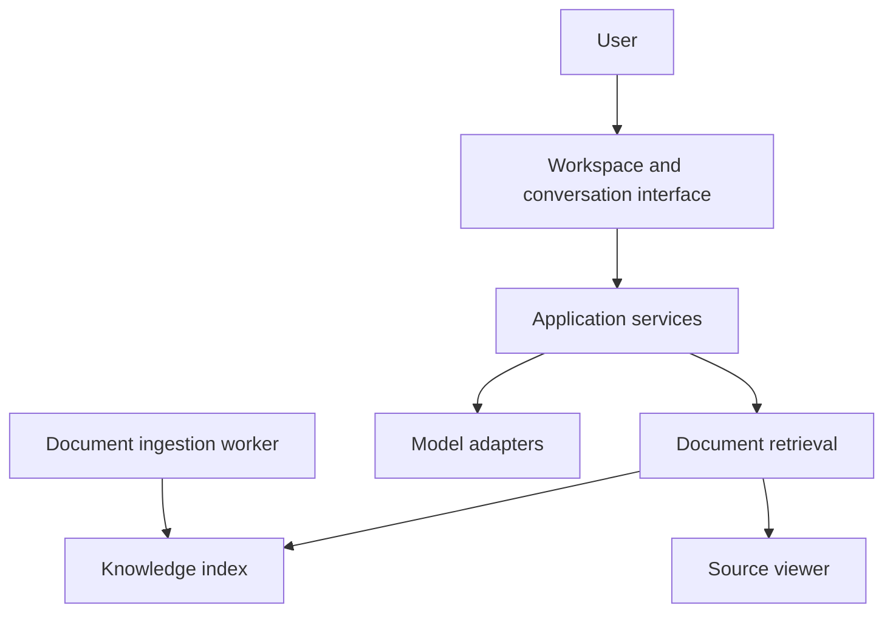

# Chatbot — Document Knowledge Assistant — Architecture

Employees can ask a question in natural language instead of searching through folders and reading entire documents. Answers arrive progressively, with citations that open the source document at the relevant page. Knowledge is organized into workspaces with controlled access.

## Components

| Component | Responsibility |
|---|---|
| Web interface | React and TypeScript conversation, document-viewing and administration screens. |
| Application API | Python/FastAPI services for conversations, permissions and document access. |
| Background worker | Document ingestion, indexing and scheduled processing. |
| Knowledge storage | PostgreSQL with vector search, document metadata and private document files. |
| Model adapters | Server-side interfaces to language, embedding and document-processing models. |

## Main interactions

## Responsibility boundaries

- Citations accompany answers. Users can check the evidence behind an answer.
- Indexing runs outside the conversation request. Document preparation does not hold up the interactive conversation.
- Access follows the workspace. Document search and viewing share the same user context.

## Constraints

An answer is an interpretation of the available sources; citations and direct document inspection remain part of the user’s workflow.

## Technology

React, TypeScript, Vite, Python, FastAPI, PostgreSQL, pgvector and Docker.
